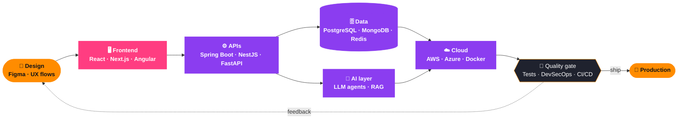
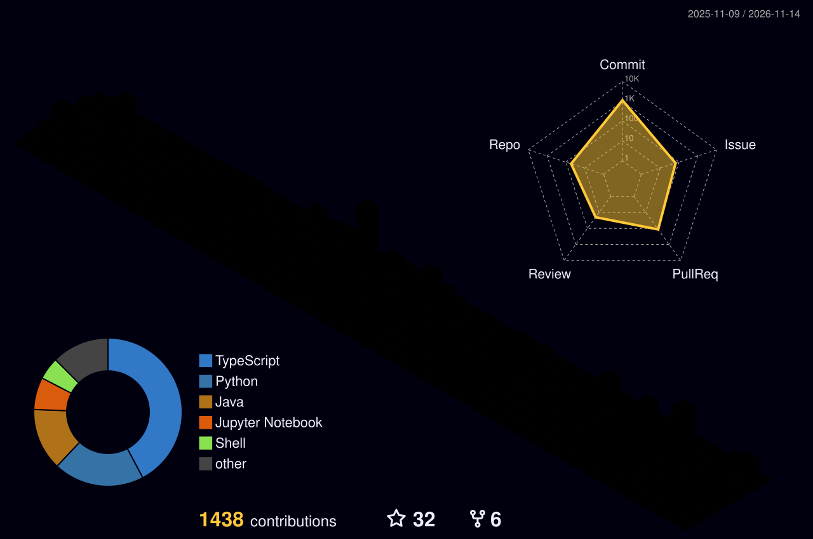

<a id="top"></a>

<div align="center">

<!-- Hero: hand-built animated SVG, lives in this repo (no third-party service) -->
<a href="https://anderssonprogramming.github.io">
  
</a>

<br/><br/>

<!-- Primary actions -->
<a href="https://anderssonprogramming.github.io"></a>
<a href="https://www.linkedin.com/in/anderssonsm/"></a>
<a href="https://leetcode.com/u/ander14_73/"></a>
<a href="https://www.hackerrank.com/profile/ander14_73"></a>
<a href="https://www.researchgate.net/profile/Andersson-Sanchez-Mendez"></a>

<br/>

<!-- Social proof -->
<a href="https://github.com/AnderssonProgramming?tab=followers"></a>
<a href="https://github.com/AnderssonProgramming?tab=repositories&sort=stargazers"></a>
<a href="https://github.com/AnderssonProgramming"></a>

<br/><br/>

<a href="#-about-me">About</a> ·
<a href="#-how-i-build">How I build</a> ·
<a href="#-tech-stack-universe">Stack</a> ·
<a href="#-featured-projects">Projects</a> ·
<a href="#-github-analytics">Analytics</a> ·
<a href="#-currently-learning--exploring">Learning</a> ·
<a href="#-lets-connect--collaborate">Connect</a>

</div>


## 🌟 About Me

I build products end to end — from the first Figma frame to the pipeline that ships it — and then I try to break them before production does. By day I work in **QA and custom software engineering at Accenture**; by night I'm finishing **Systems Engineering at ECI**, teaching the next cohort how to model databases and think in objects, and building **agentic AI systems** in the open.

<table>
<tr>
<td width="50%" valign="top">

### 💼 Professional Profile

💜 **Custom Software Engineering Associate**  
🧪 QA Support as Accenture intern

🎓 **Systems Engineering Student**  
📍 *Escuela Colombiana de Ingeniería Julio Garavito*

🧑‍🏫 **Teaching and Research Assistant**  
📊 Database Modeling & Object-Oriented Programming

🔍 Collaborative Development & Innovation

</td>
<td width="50%" valign="top">

### ⚡ Core Values

```typescript
const andersson = {
  values: ["Discipline", "Dedication", "Teamwork"],
  traits: ["Leadership", "Passion", "Communication"],
  lifestyle: {
    fitness: "Gym enthusiast 💪",
    sports: "Basketball player 🏀",
    endurance: "Long-distance runner 🏃",
    freedom: "Motorcycle rider 🏍️",
    party: "Dancer lover 🕺"
  }
};
```

</td>
</tr>
</table>

### 🧭 What I bring to a team

<table>
<tr>
<td width="25%" valign="top">

**🎨 Product-minded UI**

Interfaces that feel calm and obvious: design tokens, motion with purpose, responsive by default.

</td>
<td width="25%" valign="top">

**⚙️ Solid backends**

REST, microservices and serverless on Spring Boot, NestJS and FastAPI — secured with JWT, OAuth 2.0 and Auth0.

</td>
<td width="25%" valign="top">

**🤖 Agentic AI**

Multi-agent pipelines, RAG and coding-agent harnesses with Claude, LangGraph, LangChain and local models.

</td>
<td width="25%" valign="top">

**🛡️ A QA mindset**

Tests first, DevSecOps always: SAST, DAST, threat modeling and CI gates that say no when they should.

</td>
</tr>
</table>


## 🔁 How I build

Every project follows the same loop — and the quality gate is not optional.




## 🎨 Tech Stack Universe

The tools I reach for first, by layer. The complete inventory is one click below.

<table>
<tr>
<td width="18%"><b>🎯 Languages</b></td>
<td></td>
</tr>
<tr>
<td><b>🖥️ Frontend</b></td>
<td></td>
</tr>
<tr>
<td><b>⚙️ Backend</b></td>
<td></td>
</tr>
<tr>
<td><b>🗄️ Data</b></td>
<td></td>
</tr>
<tr>
<td><b>☁️ Cloud & DevOps</b></td>
<td></td>
</tr>
<tr>
<td><b>🤖 AI & ML</b></td>
<td> &nbsp;<code>Claude</code> <code>OpenAI</code> <code>LangChain</code> <code>LangGraph</code> <code>Ollama</code> <code>Groq</code></td>
</tr>
<tr>
<td><b>🛠️ Craft</b></td>
<td></td>
</tr>
</table>

<details>
<summary><b>🧰 Open the full toolbox (100+ technologies)</b></summary>
<br>

<b>🎯 Languages & Markup</b>
<br><br>


<br><br>
<b>⚡ Frameworks & Libraries</b>
<br><br>


<br><br>
<b>🗄️ Databases & Cloud</b>
<br><br>


<br><br>
<b>🤖 AI & Machine Learning</b>
<br><br>


<br><br>
<b>🛠️ Tools & DevOps</b>
<br><br>


</details>


## 🚀 Featured Projects

### 💎 Personal Projects

<table>
<tr>
<td width="50%" valign="top">

#### 🛡️ [Agentic Security Auditor](https://github.com/AnderssonProgramming/agentic-security-auditor)

A multi-agent security auditor for Node.js/TypeScript repos. It scans with npm audit, Trivy, Semgrep and Gitleaks, triages by CVSS, **auto-patches and validates the fixes**, then gates deployment in CI.

<code>Python</code> <code>LangGraph</code> <code>Claude</code> <code>DevSecOps</code> <code>GitHub Actions</code>

</td>
<td width="50%" valign="top">

#### 🎧 [Macenplast Voice Picking](https://github.com/AnderssonProgramming/macenplast-voice-picking)

Voice-guided warehouse picking: spoken Spanish instructions over a Bluetooth headset, barcode confirmation with **Poka-Yoke blocking**, and an offline-capable PWA.

<code>FastAPI</code> <code>PostgreSQL</code> <code>React</code> <code>TypeScript</code> <code>ElevenLabs</code>

</td>
</tr>
<tr>
<td width="50%" valign="top">

#### ✨ [TwitterLite Microservices & Auth0](https://github.com/AnderssonProgramming/secure-twitter-like-microservice-auth0)

An architectural evolution from a **Spring Boot monolith to a serverless AWS Lambda ecosystem**, secured with Auth0 and backed by DynamoDB and API Gateway.

<code>Java 17</code> <code>Spring Boot 3</code> <code>AWS Lambda</code> <code>DynamoDB</code> <code>Auth0</code>

</td>
<td width="50%" valign="top">

#### ⭐ [Enterprise-grade RAG System](https://github.com/AnderssonProgramming/rag-langchain-openai-pinecone)

A modular LangChain pipeline with **HuggingFace local embeddings** and Pinecone vector storage.

<code>Python</code> <code>LangChain</code> <code>OpenAI</code> <code>Pinecone</code> <code>HuggingFace</code>

</td>
</tr>
<tr>
<td width="50%" valign="top">

#### 👁️ [Digital Wellbeing Cloud Architecture](https://github.com/AnderssonProgramming/digital-wellbeing-cloud-architecture)

A distributed, event-driven platform to mitigate Computer Vision Syndrome: Kotlin edge ingestion, **Kafka streaming**, FastAPI microservices and XGBoost inference, provisioned with Terraform.

<code>Kafka</code> <code>FastAPI</code> <code>Kotlin</code> <code>XGBoost</code> <code>Terraform</code> <code>EKS</code>

</td>
<td width="50%" valign="top">

#### 💪 [Gym MVP — 3D Fitness App](https://github.com/AnderssonProgramming/gym-mvp)

Explore exercises by selecting body zones on an **interactive 3D model**, with sets, reps and media guides. Built by someone who actually goes to the gym.

<code>Next.js</code> <code>React Three Fiber</code> <code>Tailwind CSS</code> <code>TypeScript</code>

</td>
</tr>
<tr>
<td width="50%" valign="top">

#### 🍲 [Cocina para Uno — Dynamic Recipes](https://github.com/AnderssonProgramming/cda-front-developer)

Designed for solo cooks, it supports CRUD recipes — create, edit and favorite them with **real-time search**, category filters and local persistence. No backend required.

<code>HTML5</code> <code>CSS3</code> <code>JavaScript</code> <code>localStorage</code>

</td>
<td width="50%" valign="top">

#### ☁️ [Stock Products — Tracking with Maven](https://github.com/AnderssonProgramming/stock-products)

A stock tracking system that uses the **Observer pattern** for real-time notifications on stock changes.

<code>Java</code> <code>Maven</code> <code>Design Patterns</code>

</td>
</tr>
</table>

<details>
<summary><b>🔭 More to explore — agents, security, ML and product experiments</b></summary>
<br>

| Area | Project | What it is |
|:--|:--|:--|
| 🤖 Agents | [agentic-harness](https://github.com/AnderssonProgramming/agentic-harness) | Compass, an onboarding assistant for junior devs, built under an AI harness where the coding agent works to a written contract |
| 🤖 Agents | [UI-Physician](https://github.com/AnderssonProgramming/UI-Physician) | Agent skill that diagnoses and repairs Android layout crashes from a Logcat dump, with a bounded self-correction loop |
| 🤖 Agents | [agentState-Orchestrator](https://github.com/AnderssonProgramming/agentState-Orchestrator) | State management and orchestration plan for a lead agent and three sub-agents under context-window limits |
| 🤖 Agents | [agent-constitution](https://github.com/AnderssonProgramming/agent-constitution) | A CLAUDE.md "constitution" defining an AI coding agent's identity, rules and slash commands |
| 🤖 Agents | [local-ai-harness](https://github.com/AnderssonProgramming/local-ai-harness) | Stress test of how far Phi-3-mini on CPU-only Ollama can go before context limits break multi-file reasoning |
| 🛡️ Security | [devsecops-threat-monitor](https://github.com/AnderssonProgramming/devsecops-threat-monitor) | Shift-left and shift-right lifecycle with Falco, OWASP ZAP, Prometheus, Grafana and Loki |
| 🛡️ Security | [automated-recon-toolkit](https://github.com/AnderssonProgramming/automated-recon-toolkit) | Asyncio port scanner, Nmap XML parsing and 3-sigma log anomaly detection |
| 🛡️ Security | [secure-application-design](https://github.com/AnderssonProgramming/secure-application-design) | Split-server architecture on AWS EC2 with end-to-end HTTPS and BCrypt authentication |
| 🔬 ML & Science | [exoplanet-ml-classifier](https://github.com/AnderssonProgramming/exoplanet-ml-classifier) | Reproducible pipeline that vets NASA Kepler Objects of Interest with Scikit-Learn and XGBoost |
| 🔬 ML & Science | [cnn-architectural-aws-ai](https://github.com/AnderssonProgramming/cnn-architectural-aws-ai) | CNN vs. dense networks for Mars surface classification, run on AWS SageMaker |
| 🔬 ML & Science | [quantum-observables-simulation](https://github.com/AnderssonProgramming/quantum-observables-simulation) | Simulations of quantum observables, measurements and unitary evolution |
| 🧪 Product | [voxcesta-commerce](https://github.com/AnderssonProgramming/voxcesta-commerce) | Voice-ordering kiosk MVP where shoppers order groceries by speaking Colombian Spanish |
| 🧪 Product | [state-machine-bridge-test](https://github.com/AnderssonProgramming/state-machine-bridge-test) | Serverless order-processing state machine with 11 states and an expandable rules engine |
| 🎨 Design | [exoplanet-ml-classifier-design-system](https://github.com/AnderssonProgramming/exoplanet-ml-classifier-design-system) | Zero-dependency design system: tokens, 13 pure HTML/CSS components and a 20-slide deck |
| 🌐 Portfolio | [AnderssonProgramming.github.io](https://github.com/AnderssonProgramming/AnderssonProgramming.github.io) | My portfolio, built with React 19, TypeScript, Tailwind CSS v4 and Framer Motion |

</details>

<div align="center">
<br>
<a href="https://github.com/AnderssonProgramming?tab=repositories&sort=stargazers">

</a>
</div>

### 🤝 Collaborative Projects

<table>
<tr>
<td width="33%" valign="top">

<h4 align="center">Elysium Platform</h4>
<div align="center">
<a href="https://github.com/AnderssonProgramming/Elysium-Back">

</a>
<a href="https://github.com/AnderssonProgramming/Elysium-Front-React">

</a>
</div>
</td>

<td width="33%" valign="top">

<h4 align="center">Prometeo System</h4>
<div align="center">
<a href="https://github.com/AnderssonProgramming/Prometeo-Back">

</a>
<a href="https://github.com/AnderssonProgramming/ECI-Bienestar-Front">

</a>
</div>
</td>

<td width="33%" valign="top">

<h4 align="center">More Projects</h4>
<div align="center">
<a href="https://github.com/AnderssonProgramming/Puzzle">

</a>
<a href="https://github.com/AnderssonProgramming/Delizia">

</a>
<a href="https://github.com/AnderssonProgramming/POOB-VS-Zombies">

</a>
</div>
</td>
</tr>
</table>

### 📚 Coursework in the open

I keep my university labs public so the next student has a head start:
[**ARSW**](https://github.com/AnderssonProgramming/ARSW) · Software Architecture —
[**AREP**](https://github.com/AnderssonProgramming/AREP) · Enterprise Architecture —
[**SPTI**](https://github.com/AnderssonProgramming/SPTI) · IT Security & Privacy —
[**MLEA_M**](https://github.com/AnderssonProgramming/MLEA_M) · Machine Learning


## 📊 GitHub Analytics

<div align="center">

<picture>
  <source media="(prefers-color-scheme: dark)" srcset="https://github-stats-extended.vercel.app/api?username=AnderssonProgramming&show_icons=true&include_all_commits=true&count_private=true&hide_border=true&bg_color=0D1117&title_color=FF8C00&icon_color=A855F7&text_color=C9D1D9&ring_color=FF3D81"/>
  <source media="(prefers-color-scheme: light)" srcset="https://github-stats-extended.vercel.app/api?username=AnderssonProgramming&show_icons=true&include_all_commits=true&count_private=true&hide_border=true&bg_color=FFFFFF&title_color=D96F00&icon_color=8B3DF0&text_color=24292F&ring_color=E6266E"/>
  
</picture>
<picture>
  <source media="(prefers-color-scheme: dark)" srcset="https://github-stats-extended.vercel.app/api/top-langs/?username=AnderssonProgramming&layout=compact&langs_count=10&hide_border=true&bg_color=0D1117&title_color=FF8C00&text_color=C9D1D9&hide=Jupyter%20Notebook"/>
  <source media="(prefers-color-scheme: light)" srcset="https://github-stats-extended.vercel.app/api/top-langs/?username=AnderssonProgramming&layout=compact&langs_count=10&hide_border=true&bg_color=FFFFFF&title_color=D96F00&text_color=24292F&hide=Jupyter%20Notebook"/>
  
</picture>

<br/>

<picture>
  <source media="(prefers-color-scheme: dark)" srcset="https://streak-stats.demolab.com/?user=AnderssonProgramming&hide_border=true&background=0D1117&ring=FF8C00&fire=FF3D81&currStreakNum=F0F6FC&sideNums=F0F6FC&currStreakLabel=FF8C00&sideLabels=C9D1D9&dates=8B949E&stroke=30363D"/>
  <source media="(prefers-color-scheme: light)" srcset="https://streak-stats.demolab.com/?user=AnderssonProgramming&hide_border=true&background=FFFFFF&ring=D96F00&fire=E6266E&currStreakNum=24292F&sideNums=24292F&currStreakLabel=D96F00&sideLabels=57606A&dates=6E7781&stroke=D0D7DE"/>
  
</picture>

<br/><br/>

<!-- Generated twice a day by .github/workflows/profile-assets.yml into the `output` branch -->
<picture>
  <source media="(prefers-color-scheme: dark)" srcset="https://raw.githubusercontent.com/AnderssonProgramming/AnderssonProgramming/output/profile-night-rainbow.svg"/>
  <source media="(prefers-color-scheme: light)" srcset="https://raw.githubusercontent.com/AnderssonProgramming/AnderssonProgramming/output/profile-season-animate.svg"/>
  
</picture>


<br/><br/>

<picture>
  <source media="(prefers-color-scheme: dark)" srcset="https://raw.githubusercontent.com/AnderssonProgramming/AnderssonProgramming/output/snake-dark.svg"/>
  <source media="(prefers-color-scheme: light)" srcset="https://raw.githubusercontent.com/AnderssonProgramming/AnderssonProgramming/output/snake.svg"/>
  
</picture>

</div>


## 🎓 Currently Learning & Exploring

<table>
<tr>
<td width="50%" valign="top">

🤖 **Large Language Models (LLMs)**  
*Building conversational AI agents for automation*

📱 **Android Development with Kotlin**  
*Hybrid backend integration for mobile games*

🌐 **WebSockets & Real-Time Systems**  
*Concurrent and parallel application architecture*

</td>
<td width="50%" valign="top">

🧠 **Gemini 3 Pro Integration**  
*Multimodal AI with advanced reasoning capabilities*

🎮 **Unity Game Development**  
*C# physics engines and interactive experiences*

🔗 **n8n Workflow Automation**  
*Low-code integrations and event-driven pipelines*

</td>
</tr>
</table>


<div align="center">

## 🎯 Let's Connect & Collaborate!

Have an idea, a role, or a bug that refuses to die? My inbox is open.

<a href="https://www.linkedin.com/in/anderssonsm/"></a>
<a href="https://anderssonprogramming.github.io"></a>
<a href="https://github.com/AnderssonProgramming"></a>
<a href="https://leetcode.com/u/ander14_73/"></a>
<a href="https://www.hackerrank.com/profile/ander14_73"></a>
<a href="https://www.researchgate.net/profile/Andersson-Sanchez-Mendez"></a>

<br/><br/>

**💡 Open to collaborations · 🚀 Always learning · 🎯 Problem solver at heart**

<sub>Family, sports, music, life and everything 💜 ADSM</sub>

<br/>

<sub>README inspired by [DenverCoder1](https://github.com/DenverCoder1) · Contribution art by [Platane/snk](https://github.com/Platane/snk) and [yoshi389111](https://github.com/yoshi389111/github-profile-3d-contrib) · <a href="#top">Back to top ↑</a></sub>


</div>
